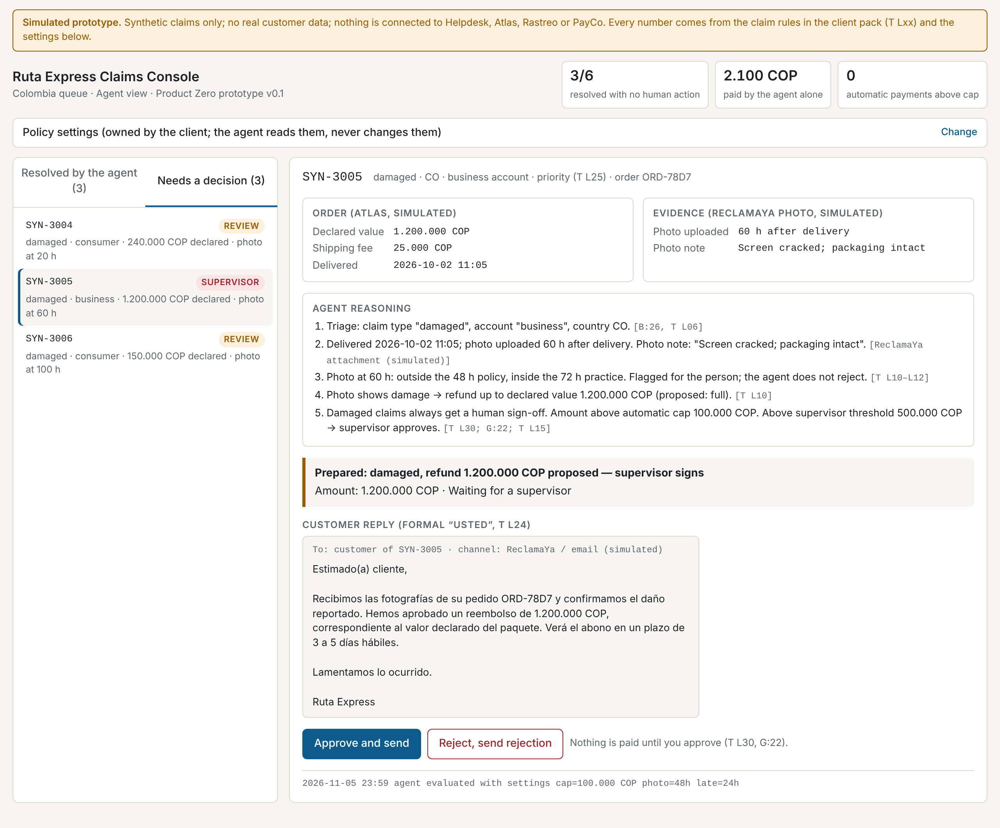

# Ruta Express — AI Claims Agent

An AI Product Management case study: framing a delivery-claims problem, deciding what an AI agent should do alone and where a person stays in the loop, and validating it with a throwaway prototype before anyone scopes the build.

> **Fictional case.** The company, people and data come from a training case written for an internal Product Practice AI Assessment. The prototype uses synthetic data only and connects to nothing.

## Try the prototype

Open [`index.html`](index.html) in a browser, or enable GitHub Pages (*Settings → Pages → Deploy from a branch → main / root*) to serve it at `https://cristhianfruiz94.github.io/ruta_express/`.



What it shows:

- **Late delivery, resolved by the agent alone.** It applies the 24-hour / 10%-of-shipping-fee credit rule, issues the credit or a "no credit" reply, and closes the claim.
- **Damaged, a person decides.** The agent checks the photo window, proposes an amount, routes above-cap claims to an agent or a supervisor, drafts a formal reply, and waits for approval.
- **Policy settings** (refund cap, supervisor threshold, photo window, late threshold, credit %). Changing any of them re-evaluates every claim live.

## The case in one page

| | |
|---|---|
| **Problem** | 22 agents handle ~4,800 claims a month by hand across four systems. ~13.5 min per claim, answers in about three days, and some refunds paid that should not have been. |
| **Intent** | Cut human minutes per claim from ~14 by letting an agent resolve what the client has already cleared, preparing everything else for a fast human decision, and never paying a refund a person should have approved. |
| **Outcome metric** | Average human minutes per claim, ~14 → ≤ 6.75 at Gate 2, guarded by refund error rate, same-day first answer and share resolved with no human action. |
| **Agent alone** | Late-delivery credits; wrong-address redelivery when the scan is > 250 m away; triage and replies. 8 of 20 open claims (40%). |
| **Person in the loop** | All damaged and lost claims; unclear wrong-address cases; any refund above the CFO's cap. |
| **Not promised** | 80% automation, "half by Q2", or a cost number. Each is measured at Gate 2. |
| **Recommendation** | Go, scoped, with three conditions. |

## Documents

| | Document | What it covers |
|---|---|---|
| ★ | [AI PM approach](docs/00_AI_PM_APPROACH.md) | The reasoning behind every decision. Start here. |
| 1 | [Problem framing](docs/01_PROBLEM_FRAMING.md) | Claims by type, handle-time baseline, hypotheses, hybrid OKR, stakeholder asks |
| 2 | [Data appendix](docs/02_DATA_APPENDIX.md) | Cleaning log, dispersion, country split, sample size, workload and FTE |
| 3 | [Gate 1 review of an AI-drafted brief](docs/03_GATE1_BRIEF_REVIEW.md) | Three issues fixed, fourteen odd-but-correct items left alone, gate call |
| 4 | [Opportunity brief](docs/04_OPPORTUNITY_BRIEF.md) | Intent, context, metric, constraints, 13 edge cases, 9 acceptance criteria, all traced to the intent |
| 5 | [Gate 1 decision memo](docs/05_GATE1_DECISION_MEMO.md) | Recommendation, day-one autonomy, confidence at Gate 2, cost approach |
| 6 | [Prototype notes](docs/06_PROTOTYPE_NOTES.md) | What the prototype taught, what it does not prove, what is simulated |
| 7 | [Privacy check](docs/07_PRIVACY_CHECK.md) | Personal data found in the client export and how it was handled |

## Repository layout

```
index.html                  prototype, served by GitHub Pages
prototype/
  claims_agent_console.html same prototype
  screenshots/              six captures of the main flows
docs/                       product documents (above)
```

Source keys used in the documents (T Lxx, B:n, M:n, G:n, CLM-xxxx) refer to lines and claims in the case's client pack, which is not part of this repository.

---

Cristhian Ruiz · AI Product Manager
